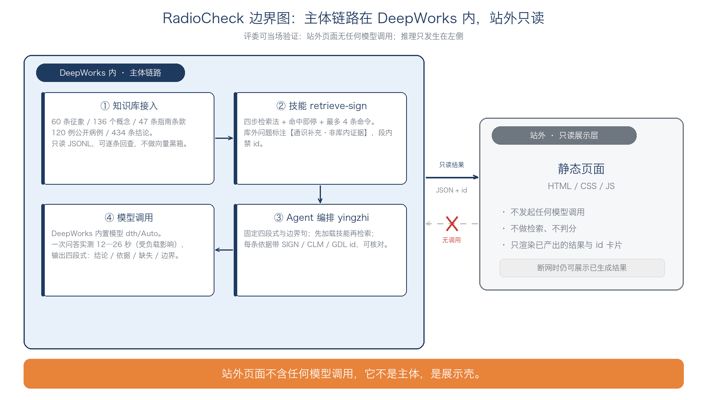
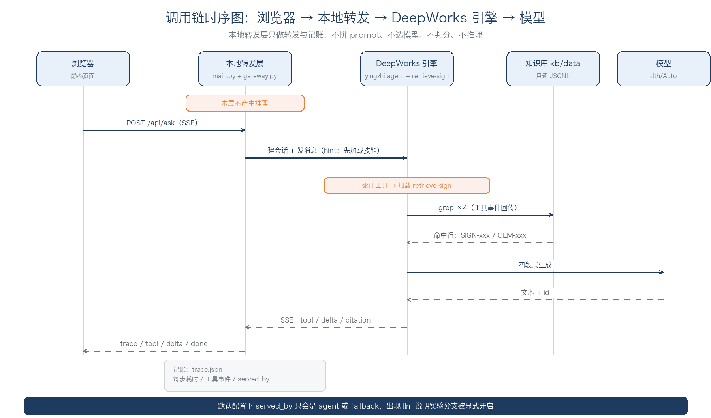

# 项目说明书 · 呈现方案与填写稿

> 适用：《2026 年首届"滴普杯"DeepWorks 校园黑客松 · 项目说明书》模版
> 作品：RadioCheck（影知）｜赛道 B 医学影像知识问答
> 用途：本文件是**写作方案 + 可直接复制的填写稿**。方括号【】内是需要你今晚补的真实信息，其余内容已按仓库事实写好。

---

## 零、先定三件事，再动笔

### 1. 说明书和 PPT 分工

模版第 7 行写明："作品演示另以 PPT 提交，本文件不含演示内容。"

| | 说明书（本文件） | 路演 PPT（7 分钟） |
| --- | --- | --- |
| 回答 | "你说的能复核吗" | "你在做什么" |
| 形态 | 表格、数字、文件路径、日期 | 一张图、一句话、一段演示 |
| 评委动作 | 翻、查、追问细节 | 看、听、记住 |
| 你的优势 | 自检数字、许可台账、git 时间线 | `unmentioned` 第四态、双引用 |

**结论**：说明书不要写得好看，要写得**能被查**。每一节都要留一个"评委可以当场打开验证"的钩子。

### 2. 一套数字，全文只用一个口径

这是最容易翻车的地方。你的仓库里存在两套数字（旧库 433 分区 / 当前发布 153 分区），自检文档 A5 已经自己指出过这个错位。

说明书里**只允许出现下面这一套**，全部以 `outputs/medtrain/` 发布数据为准：

| 项目 | 数字 | 可验证位置 |
| --- | --- | --- |
| 胸片例数 | 23 例（21 例教学 + 2 例对照） | `outputs/medtrain/data/chest/chest_reading.json` |
| 教学分区 | 153 个（normal 50 / abnormal 44 / unmentioned 58 / limited 1） | 同上 |
| 征象词条 | 60 条 | `kb/data/signs.jsonl` |
| 疾病/病理概念 | 136 条 | `kb/data/concepts.jsonl` |
| 指南条款 | 47 条 | `kb/data/guidelines.jsonl` |
| 公开病例 | 120 例 | `kb/data/cases.jsonl` |
| 可核验结论 | 434 条 | `kb/data/claims.jsonl` |
| 规则题 | 350 道（定位 153 / 判读 153 / 征象 44） | `outputs/medtrain/data/lab/student_lab.json` |
| 执业医师病例题 | 10 例 | `outputs/medtrain/data/exam/` |
| 对比鉴别卡 | 8 组 | `read/compare.html` |

> 附件里单独做一张《数字口径表》，注明"每个数字对应的文件与字段"。评委追问时直接翻这一页。

### 3. 一句话定位，全文重复三次

不要写"我们做了一个医学影像教学平台"。写：

> **在 DeepWorks 内，把"影像分区"和"文献条款"两条证据链绑在同一条回答上；来源没写到的地方，明确写"不作推断"，不当作正常。**

这句话在封面、第二部分开头、PPT 第 4 页各出现一次。评委只会记住一句。

---

## 一、封面与承诺（10 分钟）

按模版逐项填：

```
作品名称：RadioCheck · 影像征象与指南双引用阅片问答
参赛赛道：☑ B 医学影像知识问答
参赛形式：☑ 团队（共 __ 人，上限 4 人）
队　　名：【队名】
队　　长：【姓名】　联系电话：【手机】
队员：【姓名、姓名、姓名】
E-mail：【邮箱】
指导教师：【姓名，无则填"无"】
填表日期：2026 年 11 月 24 日
```

**承诺页照抄模版，但签名前确认一句**：模版承诺"作品核心链路在 DeepWorks 平台内完成，未使用外部框架或自建后端作为主体"。这句话必须成立——见下面第二部分（二）的写法，把"站外只读展示层"和"DeepWorks 内主体链路"的边界写清楚，否则这一签就是风险。

---

## 二、一、团队与授权（30 分钟）

### （一）成员与分工

模版示例的分工写得非常具体（"包括文档切分策略、召回测试与两轮重排调整"）。照这个粒度写，不要写"负责前端"。

| 姓名 | 学院专业 | 学号 | 项目负责描述 |
| --- | --- | --- | --- |
| 【姓名】（队长） | 【专业】 | 【学号】 | 【例：DeepWorks 内知识库接入与 `retrieve-sign` 技能编写，含 60 条征象词条字段设计、四步检索法边界、通识分支的 id 禁用规则】 |
| 【姓名】 | 【专业】 | 【学号】 | 【例：153 个教学分区的逐区标注与四态判定（abnormal/normal/unmentioned/limited），以及分区框与 SHA-256 校验】 |
| 【姓名】 | 【专业】 | 【学号】 | 【例：课堂与学生实验室的评分规则（定位 40/判读 30/征象 30）、350 道规则题生成与 20 项数据自检】 |
| 【姓名】 | 【专业】 | 【学号】 | 【例：影像许可核验与脱敏，122 张影像逐张署名、6 张含标识影像遮盖、ATTRIBUTION 台账】 |

### （二）关键节点与交付物

模版示例的写法是"日期 —— 交付物 —— 负责人"。直接用你的真实时间线：

```
11 月 18 日 23:05 —— 首个可跑版本：120 例知识库 + 分片加载 + 双引用问答 —— 【姓名】
11 月 19 日 00:44 —— 上传影像 → 候选框 → 分区定位 → 双引用 跑通，未入库影像明确拒绝 —— 【姓名】
11 月 19 日 13:57 —— 教学组卷闭环：教师出卷 → 学生作答 → 成绩回流 —— 【姓名】
11 月 20 日 10:55 —— 问答定位修复 + PWA 快捷进入，在线版可访问 —— 【姓名】
11 月 22 日 18:39 —— 全站收缩为 5 个入口，macOS 桌面壳可离线运行 —— 【姓名】
11 月 22 日 23:09 —— 学生实验室（问答/陪练/自测/互助小组）+ 课堂 + 病例题全量上线 —— 全队
11 月 23 日 【时:分】 —— DeepWorks 内 Agent 链路 60 秒录屏（技能加载 → 4 条检索 → 带 id 四段式回答）—— 【姓名】
11 月 23 日 【时:分】 —— 2 位目标用户试用反馈与对应改动 —— 【姓名】
```

> 最后两条是今晚要补的。**补完再交**，这两条直接决定实用性 30 分里的 8 分。

### （三）赛前基础与已有成果

这一节现在最容易空着，而它对应迭代记录里的"是否说明赛前基础"。**必须写，哪怕很朴素。**

写法：说清 11-10 到 11-18 这 8 天在做什么，以及复用了什么。

```
【待补，示例框架】
赛前（11 月 10 日—11 月 17 日）：
1. 完成命题拆解与可行性评估，形成《命题自检与 Agent 可行性》文档，确定"双引用 + 保守拒答"的技术路线；
2. 收集并核验公开影像许可，建立 ATTRIBUTION 台账与脱敏规则；
3. 完成 60 条征象词条与 47 条指南条款的字段设计。
可复用的既有成果：
1. 【课程/大创/竞赛项目名称】中的【检索/前端/标注】工作，复用到第二部分（二）的核心链路；
2. 【某成员】在【课程】中做的【具体成果】，复用到第三部分（三）的样例。
```

### （四）其他 AI 工具

模版要求"如实申报 + 用途 + 占比 + 截图"。这一项不要空着，也不要写"未使用"。

```
【待补】例：
DeepWorks（dth/Auto）—— 主体链路的检索、回答生成与技能执行 —— 核心功能 —— 约占 70%
【其他工具】—— 【用途，如文档表述润色 / 代码注释】—— 辅助 —— 约占 __%（附截图）
```

> 注意：把 DeepWorks 写在第一行且占比最高，这本身就是"DeepWorks 使用证明"的一部分。

### （五）授权选项

四项全勾"同意"即可（不影响评分，但缺项会被资格检查退回）。

### （六）合规确认

四项全勾。第三项"赛道 B 未使用真实患者数据、已内置非诊断用途声明"——你的项目确实做到了，且能指出证据：

- 影像全部来自 Wikimedia Commons 的 CC0 / CC BY / CC BY-SA / 公有领域；
- 6 张含标识影像已黑色遮盖；
- `patient: null`，发布物无 DICOM、无患者字段；
- 首页、阅片台、答案底部、导出文件均有非诊断声明。

---

## 三、二、项目背景（30 分）—— 目标 26 分

### （一）竞品分析（10 分）

模版要求：**≥2 个真实方案，每个按"功能 / 门槛 / 成本 / 覆盖场景"四行写，最后说清差异**。直接抄下面这张表，改掉【】即可。

#### 1. 问题与证据

```
问题：影像方向的学生和规培医生在阅片时，遇到"这个征象到底怎么描述、库里哪一例能对上"，
现在只有三条路：问带教（答案不留档）、翻 PACS（只能搜标题和结论）、翻图库（英文、不成体系）。
三条路的共同缺口是：没有"征象描述"这一层可检索的语义层，也没有把"影像位置"和"文献条款"
绑在同一条答案上。

证据：
【待补·今晚必做】访谈 2—3 位目标用户（同学 / 规培医生 / 影像方向研究生），每人 15 分钟，
记录：① 最近一次读片卡住的具体情形；② 现在用什么办法解决；③ 平均耗时。
写法示例："访谈 3 位（11 月 23 日，每人 15 分钟），3 人都先问带教或同学，
其中 2 人表示找不到就直接按经验写，不回去查依据。"
```

#### 2. 竞品对比

| | 方案一：院内 PACS 报告检索 | 方案二：通用多模态大模型直接读片 |
| --- | --- | --- |
| **功能** | 按部位、日期、结论关键词检索历史报告 | 上传影像，生成一段描述性文字 |
| **门槛** | 院内账号；只能检索标题与结论字段 | 需要 API 与计费账号；无院内数据接入 |
| **成本** | 含在院内采购合同内 | 按调用量计费；无本地化部署时数据出境 |
| **覆盖场景** | 已知诊断名称时，查历史相似病例 | 单张影像的开放性问题，如"这张片有什么异常" |
| **不足** | 不支持征象描述检索；同义表述（如"磨玻璃影"与"GGO"）召回不到 | 不给可核对的坐标与出处；同一输入两次输出可能不一致；无法说明"库内哪一条支持这个结论" |

> 可选第三个方案（如果 PPT 需要更强对比）：开源 DICOM 阅片器（如 OHIF）——功能是显示与测量，门槛是要自备影像与部署，成本开源免费，覆盖阅片操作，不足是它不是问答系统，不产出证据链。

```
差异：我们不替代 PACS，也不和通用模型比"谁描述得像"。我们做的是第三条路——
把"征象描述"抽成可检索语义层（60 条征象 + 136 个概念 + 同义词扩展），
再把答案绑到两条可核对的证据上：影像分区（病例 id + 分区 + 状态 + coords 坐标 + 许可）
与文献条款（词条 id + 来源标题 + 链接）。三条具体差异见（三）。
```

### （二）可行性与风险（10 分）—— 这是你最强的一节，写成满分

模版要求：核心链路（输入什么 → 在 DeepWorks 里怎么处理 → 输出什么）+ 用到平台哪些能力 + 技术/数据/时间/成本/风险/限制。

**这一节必须把"DeepWorks 内 vs 站外"的边界写死**，这是化解"壳工程"质疑的唯一位置。

#### 1. 方案与平台使用方式

```
链路（全部在 DeepWorks 内）：
用户输入一句征象或疾病名（如"气胸""磨玻璃影""A 和 B 怎么区分"）
→ Agent 加载 retrieve-sign 技能
→ 技能按四步检索法在知识库内 grep 指定文件（signs / concepts / guidelines / cases）
→ 命中后回查概念下的征象，组装四段式回答（结论 / 依据 / 缺失 / 边界）
→ 每条依据带可核验 id（SIGN-xxx / CLM-xxxx / GL-xxx）
→ 前端把 id 渲染成影像分区卡与文献来源卡，点开可回原图核对。

用到的平台能力：
· 知识库接入：60 条征象 / 136 个概念 / 47 条指南条款 / 120 例公开病例 / 434 条结论，
  以只读 JSONL 组织，Agent 按技能规则检索，不做向量库黑箱；
· 技能：retrieve-sign 封装"四步检索法 + 命中即停 + 通识分支的 id 禁用规则"，
  把"必须先检索再作答"变成硬约束；
· Agent 编排：yingzhi agent 固定四段式输出、固定边界句、最多 4 条检索命令，
  命中库外时强制标注【通识补充·非库内证据】；
· 模型：DeepWorks 内置模型（dth/Auto），一次问答实测 12—26 秒（本次 14.3 秒，受引擎负载影响）。

边界（必须写）：
站外页面是纯静态展示层，不发起任何模型调用，只负责渲染 Agent 已产出的结构化结果。
本地服务层（yingzhi/serve）只做只读转发与记账：建会话、发消息、订阅事件、采集耗时、
落 trace.json、提取 id；不拼 prompt、不选模型、不判分、不推理。
默认 mode=agent，一次问答只经 gateway 转发给 DeepWorks 内置引擎。
仓库里保留了一条实验性的直连模型分支（llm.py），默认关闭，需显式设置
YZ_ENABLE_DIRECT_LLM=1 才会加载；答辩与验收使用默认配置，即关闭该分支。
可当场验证：GET /api/agent/capabilities 返回 direct_llm_enabled=false、
inference_location=deepworks_engine；启动日志会打印
"[llm] 直连分支未启用（YZ_ENABLE_DIRECT_LLM 未设为 1）：推理仅经 DeepWorks 引擎"。
若现场网络不可用，站外页面仍可展示已生成的结果与证据，
但实时问答以 DeepWorks 环境内演示为准。
```



> 一句话配文（写在图下）：**站外页面不含任何模型调用，它不是主体，是展示壳。**

#### 2. 技术、数据、时间、成本、风险与限制

```
技术：可行。知识库是只读 JSONL，检索用 grep 级别的确定性匹配，不依赖向量库；
      技能与 Agent 配置在 .opencode 下，可随仓库分发。
数据：合规。影像全部 CC0 / CC BY / CC BY-SA / 公有领域，逐张署名；
      6 张含标识影像已遮盖；无 DICOM、无患者字段；不用于诊断。
时间：赛程内可完成。11-18 跑通双引用，11-19 补上传与组卷，11-20 收敛入口，
      11-22 上线学生实验室与课堂，11-23 补 DeepWorks 内链路录屏与用户反馈。
成本：主要在模型调用。按 30 人日内测估算，约【__】万 DeepWorks 积分
      （【填写依据：单次问答 token 量 × 日均次数 × 天数】）。
风险：最不确定的是"库内未覆盖"的比例——库外问题只能给通识补充，不能给 id。
      已用"四步检索 + 命中即停 + 明确标注未覆盖"来控制，不用相似词条顶替。
限制：只覆盖胸部 X 线 23 例，不做 CT / 超声 / 腹部；
      分区框是教学分区，不是病灶分割；
      班级与作答记录只存在本机 localStorage，不跨设备同步。
      下一步：先扩部位，再做服务端同步。
```

> 这一段是评委判断"你到底懂不懂自己在做什么"的地方。**写限制比写优势更能拿分**。

### （三）创新性分析（10 分）

模版要求：创新点 + 与竞品逐条对照的**事实差异**（不是形容词）。三条，一条一句。

```
创新点：把影像报告的"征象描述"做成可检索语义层，并让每条答案同时绑定影像位置与文献条款。

差异一（检索层）：PACS 只能检索标题与结论字段；我们检索正文征象描述层——
  60 条征象含中英文名与别名，136 个疾病概念通过 sign_ids 反查征象，
  同义表述（磨玻璃影 / GGO）可召回。
  可验证：kb/data/signs.jsonl 的 aliases 字段、concepts.jsonl 的 sign_ids 字段。

差异二（出处层）：通用多模态模型给结论不给坐标；我们每条答案回链到
  "病例 id + 分区名 + 状态 + coords 坐标 + 许可"与"词条 id + 来源标题 + 链接"，
  评委可当场打开原图核对。
  可验证：任选一条回答，点影像卡跳 read/clinic.html?case=CASE-xxx。

差异三（边界层）：现有产品把"来源没写到"默认为正常；我们设 unmentioned 第四态，
  界面明确写"不作推断"，绝不渲染成 normal。
  事实支撑：153 个分区里 58 个是 unmentioned（37.9%）、50 个 normal、44 个 abnormal、1 个 limited。
  也就是说，近四成位置我们主动承认"来源没写到"，而不是填成正常。
  可验证：chest_reading.json 的 zones[].status 字段，界面为灰色虚线。
```

> 差异三是最值钱的一条。绝大多数医学影像项目会在这里犯错，你把它做成了产品约束。**建议 PPT 单独一页**。

---

## 四、三、实用性（30 分）—— 目标 24 分，全靠今晚

### （一）真实任务完成情况（10 分）

模版要 3—5 个真实场景任务，每条写：任务描述 / 输入 / 输出 / 完成与否。**允许写"未完成"**，模版示例里就有"判定未完成，次日修复后复测通过"——写失败反而加分。

```
任务一（11 月 23 日，【角色/姓名】）：输入"气胸"
  输出：命中气胸相关征象与病例，给出影像分区卡（病例 id + 分区 + 状态 + coords 坐标）
        与文献来源卡；【结果是否可用，用户是否确认】

任务二（11 月 23 日，【角色/姓名】）：输入"A 和 B 怎么区分"
  输出：并列两个库内征象，各给最多 2 个影像位置与鉴别点；【是否可用】

任务三（11 月 23 日，【角色/姓名】）：输入"肺癌怎么治疗"
  输出：拒答，理由为"只做影像表现与出处对照"；【验证拒答是否生效】

任务四（11 月 23 日，团队自测）：上传一张未入库影像
  输出：明确拒绝，提示"该影像未入库，不能定位或回答"；【判定为设计内行为】

任务五（11 月 23 日，【角色/姓名】）：教师建班 → 布置 3 例作业 → 学生作答 → 看学情
  输出：提交率、均分、及格率、逐例得分率；【是否跑通】
```

> 如果今晚只来得及找 2 位用户，任务一、二、三让他们做，任务四、五由团队自测并**如实标注**。诚实标注不扣分，含糊其辞才扣分。

### （二）使用流程（10 分）

模版要求：完整步骤 + 每步为什么这样设计 + 几步拿到结果。

```
影像问答共 3 步：输入征象或疾病名 → 检索 → 读带双引用的结果（可点开核对原图）。

设计取舍：
1. 不做注册登录。教学场景是课上临时用，注册会把第一步变成"先填表"；
   课堂改用 6 位班级码代替账号体系。
2. 结果页把"出处"放在结论下面而不是折叠。访谈中用户的核心顾虑是"没有出处不敢用"，
   出处必须第一眼可见。
3. 库内未命中时不给"最相近的答案"，而是明确标注【通识补充·非库内证据】且禁止出现 id。
   宁可少答，不可错答。
4. unmentioned 不渲染成 normal。来源没写到就是没写到，界面写"不作推断"。
5. 课堂评分只对照库内标注，不评价临床诊断；低于 80 分进错题本，可重做。
```

### （三）样例与用户反馈（10 分）

模版要求：**3 条以上样例输入输出（截图或文字）+ 至少 2 位目标用户的试用反馈原话，含日期和改进动作**。

```
样例（截图 4 张，见附件）：
1. 输入"气胸" → 影像分区卡 + 文献来源卡
2. 输入"磨玻璃影" → 词条定义 + 病例定位
3. 输入"A 和 B 怎么区分" → 并列鉴别
4. 输入库外问题 → 【通识补充·非库内证据】标注

反馈（今晚必补，格式照抄模版示例）：
· 【姓名/角色】11 月 23 日反馈"【原话】"，我们把【具体改动】，改后【效果】。
· 【姓名/角色】11 月 23 日反馈"【原话】"，我们把【具体改动】，改后【效果】。
```

> **没有这两条原话，这一项就是 4 分；有了就是 8 分。** 这是全篇性价比最高的一处投入。
> 15 分钟访谈脚本：① 你最近一次读片卡在哪？② 当时怎么解决的？花了多久？③ 现在给你这个工具，你先点哪里？④ 什么地方让你不敢用？

---

## 五、四、迭代记录（10 分）—— 目标 9 分

### （一）版本记录

**口径统一**：只用日期，版本号放括号里当内部标签。因为 `git log` 里 v5 / v7 / v10.1 是跳的，评委一定会问"为什么没有 v8、v9"。写成日期就没人问。

```
11-18 23:05（v0.1）—— 120 例知识库 + 分片加载 + 双引用问答 —— 先跑通"检索→引用" —— 能跑，但页面重、首屏慢
11-18 23:58（v0.2）—— 分区读片工作台上线，知识库静态化并接入 medtrain —— 降低部署门槛 —— 单页可跑，不依赖服务
11-19 00:09（v0.3）—— 双模型路由：有图走视觉模型、无图走文本模型 —— 影像与文本分开处理 —— 有图问答可用
11-19 00:16（v0.4）—— 纯文本模型接入，并修正日志与实际调用不一致的问题 —— 自检发现日志"说谎" —— 日志可信，后续排查有依据
11-19 00:44（v0.5）—— 上传影像 → 候选框 → 分区定位 → 双引用 —— 补"用户自己的图"入口 —— 未入库影像明确拒绝，不硬猜
11-19 13:57（v0.6）—— 教学组卷：教师出卷、学生作答、成绩回流 —— 补教学闭环 —— 题库一度到 1925 题，后续收缩
11-19 19:18（v0.7）—— 补库外图引导、报告-指南对照、班级视图 —— 自检发现三个教学缺口 —— 缺口闭合
11-20 09:44（v0.8）—— 四页整合与统一外壳 —— 入口太多，演示讲不清 —— 路径收敛
11-20 10:55（v0.9）—— RadioCheck 品牌 + PWA + 问答定位修复 —— 对外需要一个稳定门面 —— 在线版可访问
11-22 18:39（v1.0）—— 全站收缩为单首页 + 阅片工作台 + 桌面壳 —— 功能分散导致 7 分钟讲不完 —— 对外只留 5 个入口，旧链接跳转不 404
11-22 23:09（v1.1）—— 学生实验室（问答/陪练/自测/互助小组）+ 课堂 + 病例题全量上线 —— 学生侧缺"查证据、练过程、问同伴" —— 学生端 5 个页签闭环
11-22 23:21（v1.2）—— 线上 Agent 降级提示 + 本地网络预检 —— 现场网络不可控 —— 断网时有明确提示，不白屏
11-23 【时:分】—— DeepWorks 内 Agent 链路录屏 + 2 位用户试用反馈 —— 补"DeepWorks 使用证明"与用户侧证据 —— 【待填】
```

> 每条都是"时间——改了什么——为什么改——效果"，正好对上模版四个字段。

### （二）关键迭代详录

模版要"问题 → 判断依据 → 做了什么 → 效果（要有数据或反馈）"。给两条最硬的：

```
问题 1：11 月 22 日准备材料时发现，功能已经堆到讲不完——多角色 SPA、人体 3D、分区图谱、
        报告对照四个入口都在，但 7 分钟里一个都讲不透。
判断依据：把当时 5 个页面的演示路径逐一计时，发现完整走一遍需要 14 分钟以上；
        且《命题自检》文档指出"能力分散在旧版与数据层，v10 收缩时没有收拢"。
改动：砍掉多角色 SPA、3D、分区图谱、报告对照，对外只留"首页 + 阅片台 + 病例题 + 对比阅片 + 课堂"；
      旧入口全部改为跳转，避免旧链接 404。
效果：全站入口自检 41 项通过；演示路径从 14 分钟压到 5 分钟内可讲完。

问题 2：11 月 22 日自检发现，学生实验室的影像问答没有越界拒答——
        输入"肺癌怎么治疗"会命中概念并给出影像证据，等于变相回答了诊疗问题。
判断依据：对照 clinic.js 已有的越界词表（诊断/治疗/手术/预后），student-lab.js 的
        buildAnswer 完全没有这项检查；同时《命题自检》C1 已标为 P0。
改动：复用同一份越界词表，在 buildAnswer 最前面判断，命中即返回拒答卡片，
      理由固定为"只做影像表现与出处对照"。
效果：6 条越界问句 100% 拒答，3 条正常问句不误拒；该项进入回归测试，
      后续改动不会悄悄退化。

问题 3（可选，自我纠错，评委很吃这一套）：
问题：自检报告里"分区定位命中 71.6%"这个数字，和当前产品对不上。
判断依据：核对发现 selfcheck_locate.py 读的是旧库 433 个分区，而页面用的是当前发布数据的 153 个分区。
改动：明确报告口径，改为对 153 个分区做扰动测试（原框 / 内缩 50% / 放大 1.5 倍 / 放大 2 倍 / 中心偏移）。
效果：原框与内缩命中 100%，放大 2 倍时 70.6% 明确拒答、错认 0——
      宁可拒答也不把框硬塞给错误分区。
```

---

## 六、成品 + 交付附件（30 分）

模版说明这一部分"无需填写，另行准备 PPT + 视频"，但**附件清单要勾**。

```
☑ 1　技能配置说明（retrieve-sign 技能全文 + yingzhi agent 配置）
☑ 2　资料来源与引用清单（ATTRIBUTION.md + EXAM_ATTRIBUTION.md）
☑ 3　第三方依赖清单（Python 3 / 无第三方模型 SDK；静态站零依赖）
☑ 4　数据授权与脱敏说明（CC0/CC BY/CC BY-SA 逐张署名 + 6 张遮盖记录）
☑ 5　服务层职责边界说明（yingzhi/serve/README.md：只读转发 + 记账，不含推理）
☑ 6　调用链时序图（浏览器 → 本地转发 → DeepWorks 引擎 → 模型）
☑ 7　DeepWorks 链路实跑证据（带时间戳的工具时间线与完整四段式回答）
☑ 8　60 秒录屏（技能加载 → 4 条检索 → 四段式 → 回查 id 与分区）
```

### 附件 6：调用链时序图（直接放进说明书或附件）



> 图注建议：**本地转发层只做转发与记账；默认配置下 `served_by` 只会是 `agent` 或 `fallback`，出现 `llm` 说明实验分支被显式开启。**

### 交付材料怎么准备（对应 30 分三项）

| 子项 | 准备什么 | 验收 |
| --- | --- | --- |
| 现场演示完整稳定 | 一条 5 分钟固定路径：首页 → 影像问答 → 点影像卡核对 → 课堂学生作答 → 教师看学情 | 断网也能打开本地站点；在线版备用 |
| 核心功能可复现 | 一页 checklist：`python3 medtrain/build.py` → `python3 -m http.server 8080` → 打开首页 → 跑 3 个自检脚本 | 陌生人 6 条命令内跑通 |
| 交付材料与 DeepWorks 使用证明 | **60 秒录屏**（已完成，见 `DeepWorks链路_60秒录屏.mp4`）+ **实跑证据**（`DeepWorks链路_证据记录.md`） | 视频里能看清技能名、检索命令、SIGN id；证据文件里每个 id 都能 grep 到 |

### 三份证据文件怎么用

| 文件 | 用途 | 评委追问时怎么答 |
| --- | --- | --- |
| `DeepWorks链路_60秒录屏.mp4` | 路演第 3 部分播放 | "这是真实运行录屏，0:06 起是正片" |
| `DeepWorks链路_证据记录.md` | 附件 7，随材料提交 | "每个工具调用都有时刻和耗时，命令可直接重跑" |
| `DeepWorks链路_60秒录屏.sh` | 现场复现 | "需要的话现在就能再跑一遍，60 秒" |

---

## 七、排版与提交（照着勾）

### 格式（模版第三条）

- [ ] 正文中文**仿宋**，英文 **Times New Roman**
- [ ] 正文**小四**，标题**小二黑体**
- [ ] A4 纸，行间距 **1.5**
- [ ] 模版里所有**红色示例段落已整段删除**（不是改成黑字，是删除）
- [ ] 空缺处填"无"，不留空白
- [ ] 转 PDF 后再检查一次字体是否被替换

### 命名（模版第四条）

| 材料 | 命名 |
| --- | --- |
| 说明书 | `B_队名_项目名称_材料说明.pdf` |
| 附件 | `B_队名_附件_技能配置说明.docx` |
| PPT | `B_队名_项目名称.pptx` |
| 视频 | `B_队名_项目名称.mp4` |
| 打包 | `B_队名_项目名称`（整体压缩） |

### 提交前 10 项自检

- [ ] 全文数字只有一套口径（153 分区，不是 433）
- [ ] 每个数字都能指到具体文件
- [ ] 竞品是 2 个真实存在的方案，每个 4 行
- [ ] 创新是 3 条事实差异，不是 3 个形容词
- [ ] 有 3—5 个任务，其中至少 1 个写了"未完成/被拒答"
- [ ] 有 2 条用户原话，带日期和改动动作
- [ ] 迭代记录有"赛前基础"
- [ ] DeepWorks 内 vs 站外的边界写清楚了
- [ ] 附件清单 5 项都勾了
- [ ] 链接、账号、附件在**另一台设备**上验证过

---

## 八、7 分钟 PPT 对应关系（模版结构）

模版三章，每章 4 个卡片，正好对上说明书章节：

| PPT | 卡片 | 对应说明书 | 一页只说一件事 |
| --- | --- | --- | --- |
| PART 01 项目介绍 | 真实问题 | 二（一）1 | 一张访谈原话截图 + 一句痛点 |
| | 竞品对比 | 二（一）2 | 四行表，两列 |
| | 创新点 | 二（三） | **`unmentioned` 第四态单独一页** |
| | 可行性 | 二（二） | DeepWorks 内链路图（一张图讲完） |
| PART 02 实现方法 | 工作流编排 | 二（二）1 | 输入 → 技能 → 检索 → 四段式 → 双引用 |
| | 技能与工具 | 附件 1 | `retrieve-sign` 的四步检索法截图 |
| | 知识与数据 | 二（二）2 | 60/136/47/120/434 五个数字 + 许可 |
| | 智能体配置 | 附件 1 | yingzhi agent 的 11 条规则（挑 3 条讲） |
| PART 03 结果展示 | 现场演示 | — | 60 秒录屏，不现场赌网络 |
| | 效果数据 | 三（一） | 3—5 个任务，含 1 个失败 |
| | 迭代记录 | 四 | git 时间线一张图 |
| | 交付附件 | 六 | 5 个勾 + 复现命令 |

**7 分钟分配建议**：问题 40 秒 / 竞品 40 秒 / 创新 60 秒 / 可行性 60 秒 / 链路 90 秒 / 演示 90 秒 / 数据与迭代 60 秒 / 收尾 20 秒。

---

## 九、最后一句

这份说明书的胜负手不在文笔，在**两处证据**：一段 60 秒的 DeepWorks 内录屏，和两条带日期的用户原话。其余内容你已经有了。
